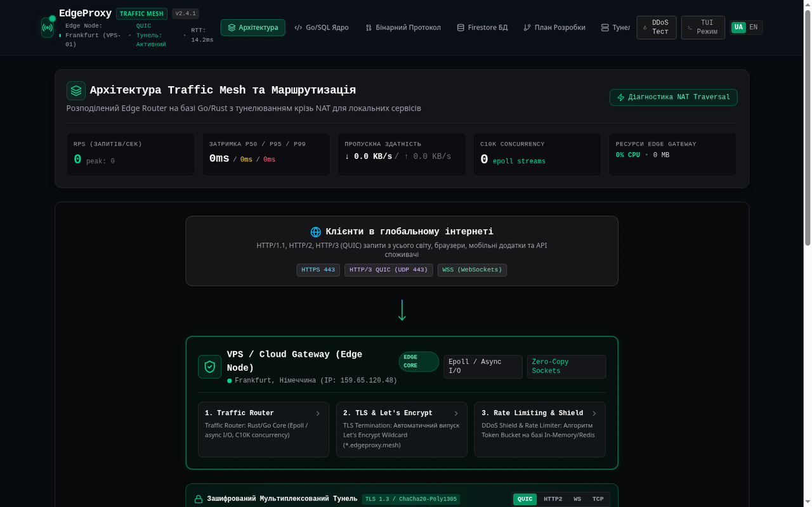

# EdgeProxy & Traffic Mesh

High-performance edge reverse proxy, binary multiplexing tunnel and DDoS shield. The project combines a Go data plane, a Go CLI agent, a Node.js control plane and a React dashboard.



## Architecture

EdgeProxy follows a clean separation of concerns between high-throughput networking, agent tunneling and control-plane management:

```text
├── gateway/                 # Go edge ingress gateway
├── agent/                   # Go local CLI agent
├── db/                      # PostgreSQL schema and migrations
├── server.ts                # Node.js control plane and API
├── src/                     # React dashboard
├── go.work                  # Go workspace
├── Makefile
└── docker-compose.yml
```

### Data flow

- **Data plane (Go):** public HTTP/HTTPS traffic is terminated by the Go gateway and forwarded through the binary tunnel protocol.
- **Local agent (Go):** authenticates to the gateway and forwards traffic to local services.
- **Control plane (Node.js/React):** provides the dashboard, REST API, WebSocket telemetry and configuration. It does not proxy customer traffic in production.

## Quick start

### Build binaries

```bash
make build
```

### Run the edge gateway

```bash
./bin/edgeproxy-gateway -http-port 8080 -tls-port 8443 -tunnel-port 4242 -domain edgeproxy.mesh
```

### Run the CLI agent

```bash
./bin/edgeproxy-agent -gateway 127.0.0.1:4242 -port 3000 -subdomain demo
```

### Run the web control plane

```bash
npm install
npm run dev
```

Open `http://localhost:3000`.

## Security notes

- AI telemetry diagnosis runs on the backend through server-side environment variables.
- If no AI key is configured, deterministic heuristic rules are used.
- The gateway includes rate limiting and flood protection.

## License

This project is licensed under the [MIT License](LICENSE).

## Українською (коротко)

EdgeProxy — високопродуктивний edge reverse proxy з тунелюванням, CLI-агентом, веб-панеллю керування та захистом від DDoS. Go обробляє трафік, Node.js/React відповідають за керування та телеметрію. Запуск панелі: `npm install && npm run dev`.